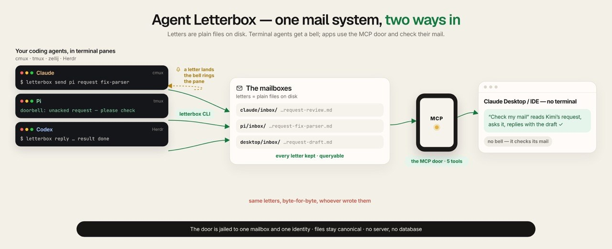
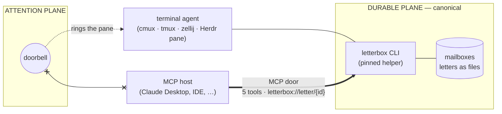

# Letterbox MCP door



**Give any MCP app a seat at your agent team's mailbox.**

[Agent Letterbox](https://github.com/SimonMallas/agent-letterbox-cmux) is durable mail between AI coding agents:
letters as plain files on disk, a doorbell that wakes the recipient's terminal pane, and a queryable record of who
asked, who answered and what is still owed ([QEM](https://github.com/SimonMallas/agent-letterbox-cmux/blob/main/ARCHITECTURE.md)).

Until now a seat needed a terminal. **This door removes that requirement**: Claude Desktop, an IDE, any MCP client
can hold a mailbox as a first-class participant — check it, read letters, send, reply, file. Underneath, the door
shells out to the same pinned Letterbox CLI, so a letter written through it is byte-identical to one written in a
terminal: same envelope, same lifecycle, same record. **Five tools, one identity, files stay canonical.**

```text
letterbox-mcp --mailbox /path/to/box --agent alpha
```

## Two planes, one door

Letterbox has two planes. The door exposes only one of them.



```text
DURABLE PLANE   files + CLI. Owns letters, identity, state, lifecycle. Canonical.
ATTENTION PLANE the doorbell. Signals that durable mail exists.
                It does not carry the letter, does not prove consumption,
                and DOES NOT REACH MCP HOSTS. A desktop seat is pull-only.
```

MCP may expose the durable plane. It must never collapse the two.

## Law

1. CLI and files are the source of truth. MCP is a view. Any disagreement is a tool error carrying the CLI's own words.
2. `check` never returns bodies. `read` is one id. `include_body` defaults false.
3. No search tool. No bridge tokens, allowlists or chat ids in any schema, URI, log line or structured content.
4. One resource template, `letterbox://letter/{id}`. Never `file://`. Unknown id is an error, never an empty letter.
5. No decision-critical outcome exists only in `structuredContent`. Server-authored text is the compatibility contract.
6. MCP capabilities describe this adapter, not Letterbox. Absent `resources.subscribe` does not mean Letterbox cannot
   notify; notification lives on the attention plane, outside MCP.
7. The door is jailed to ONE mailbox and ONE identity. It can read and write only that participant's own mail.
   One writer per identity; the door does not weaken it.
8. Relay-originated letters (an external bridge's correspondence) cannot be replied to or filed through the door;
   their lifecycle belongs to the bridge that carried them.

## The five tools

| Tool | Does | Writes? |
|---|---|---|
| `letterbox_check` | List open letters (headers only, never bodies) | no |
| `letterbox_read` | One letter by id; `include_body` defaults false | no |
| `letterbox_send` | A new letter (`to`, `type`, `subject`, `body`; rings the recipient) | yes |
| `letterbox_reply` | `ack` / `nack` / `result` on a letter in this inbox | yes |
| `letterbox_file` | Move a non-task letter to processed (content hash unchanged) | yes |

## Requirements

- Python ≥ 3.11; official Python MCP SDK (pinned in `pyproject.toml`); stdio transport, protocol 2025-11-25.
- A **pinned Letterbox CLI helper**. `LETTERBOX_CLI` is **required**: the door shells out to the CLI for writes and
  refuses to run one without the pin. Verify the helper by manifest (`shasum -a 256 -c MANIFEST.sha256`) at deployment
  and again before any live session.
- A mailbox and a **registered identity** for the host. The identity must exist as a participant before the door
  starts; the door will not invent one.

## Install

Install into **its own worktree with its own venv** — never a development checkout's editable install (an editable
install runs whatever uncommitted files the dev repo carries; the stage-3 checklist requires evidence of which code
will run).

```bash
git worktree add ~/letterbox-mcp-<purpose>-<sha8> <reviewed-commit>
cd ~/letterbox-mcp-<purpose>-<sha8>
python3 -m venv .venv && .venv/bin/pip install .
```

Verify what will actually run:

```bash
.venv/bin/python -c 'import letterbox_mcp; print(letterbox_mcp.__file__)'   # a path INSIDE this worktree
.venv/bin/pip show letterbox-mcp     # must NOT name a dev repo as an editable location
git rev-parse HEAD && git status --short   # record both; status must be empty
```

## Configuring a host — Claude Desktop example

Config: `~/Library/Application Support/Claude/claude_desktop_config.json` (mode 600). **Back it up first** (`cp -p` to
a dated sibling; record sha256 of both). Add ONE server beside whatever is already there; do not edit existing entries:

```json
"letterbox-live": {
  "command": "/Users/you/letterbox-mcp-<purpose>-<sha8>/.venv/bin/letterbox-mcp",
  "args": ["--mailbox", "/Users/you/path/to/bus", "--agent", "desktop"],
  "env": { "LETTERBOX_CLI": "/path/to/pinned/helper/bus.sh" }
}
```

Restart the host and confirm the server lists exactly **five** tools.

## Safety — read before the first live session

- **There is no read-only mode in v1.** The door advertises all five tools, always. Treat every live session as
  **supervised**: a human approves or denies each write. **Never set `letterbox_send`, `letterbox_reply` or
  `letterbox_file` to "Always allow".**
- **Relay-originated letters cannot be replied to or filed through the door.** A phone question is answered on the
  phone, by the bridge that carried it.
- **Snapshot discipline for a first attach:** snapshot the mailbox before and after, diff, and apply the one-pass
  rule — byte-identical, or every difference traced to a specific logged action inside the window. An untraced
  difference fails the session, whoever caused it.
- **Abort rule:** if the host attempts a write you did not expect, deny it. If one executes anyway: quit the host,
  take the after-snapshot, roll back, trace the write. A send may already have rung a seat — say so.
- Consumers of `structuredContent` and `resources/read` are handling untrusted data and must render it safely.

## Limits (v1, by design)

- **No bell into MCP hosts.** A desktop seat is pull-only; its habit is check-at-start. Nobody is coming to wake it.
- **No query (QEM), no progress verb, no supersedes on send.** The durable record underneath supports all three; the
  door does not expose them yet.
- `letterbox_reply` is `ack | nack | result` only — a mid-task progress note is a new letter referencing the thread.
- Reply writes are jailed: participant-bound `from`, derived ids, no-follow into the target inbox. A non-TTY pipe that
  never reaches EOF may still block the underlying CLI (known accepted limit, from the CLI).

## If something goes wrong

1. Quit the host.
2. Restore the config backup; verify its sha256 matches the recorded one.
3. Leave the worktree and pinned helper in place until evidence is filed.
4. An MCP-written letter looks like: `from: <identity>` in frontmatter, in some participant's inbox, mtime inside the
   session window — `grep -l '^from: desktop' <bus>/*/inbox/*.md`.

## Proven

These claims are not aspirations. The door passed a supervised read-only pilot (byte-identical mailbox), a scripted
first-write comparison (door letter byte-identical to a CLI letter), live reply/file/thread mechanics, and a
supervised real-task trial in which a desktop seat acknowledged and answered a genuine request with byte-perfect
lifecycle evidence. Every stage was independently verified by a second reviewer.

This repository is private until publication is explicitly authorised.
